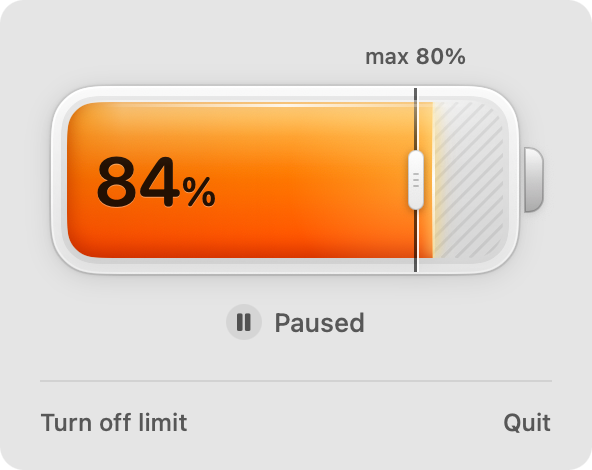

# BatteryGuard

A free, open source menu bar app for Apple Silicon Macs that does one thing: it stops charging at the limit you choose, between 50% and 80%.

Built for Macs that stay plugged in all day and night, so the battery doesn't sit at 100%.



## Requirements

- Mac with Apple Silicon (M1 or later)
- macOS 13 Ventura or later

## Install

1. Download `BatteryGuard-x.y.z.dmg` from [Releases](../../releases/latest).
2. Open it and drag BatteryGuard to Applications.
3. BatteryGuard is not signed with an Apple Developer ID, so macOS blocks it the first time. Open **System Settings > Privacy & Security**, scroll down and click **Open Anyway**. You may need to do this for the disk image and then for the app.
4. Click **Turn on charge limit** and enter your administrator password. This is needed once, to install the background service that controls charging.

Check the download against `SHA256SUMS` if you want:

```bash
shasum -a 256 -c SHA256SUMS
```

### From Terminal

```bash
curl -fsSL https://github.com/alessiocardelli/batteryguard/releases/latest/download/install.sh | bash
```

The [script](scripts/install.sh) checks your Mac (Apple Silicon, macOS 13+), downloads the latest zip, verifies it against `SHA256SUMS`, quits BatteryGuard if it's running, copies it to `/Applications` and opens it. Files downloaded with `curl` aren't quarantined, so there's no **Open Anyway** step. It doesn't install the background service: you still turn on the limit from the app (step 4 above). Run it again to update.

## How it works

- The app installs a small background service (`/Library/PrivilegedHelperTools/com.alessiocardelli.batteryguard.helper`, started by `launchd`).
- Every few seconds the service reads the battery level. At the limit it tells the Mac's power controller (SMC key `CHTE`, or `CH0B`/`CH0C` on older firmware) to stop charging; it resumes 2% below the limit. On the newest firmware (keys `bfF0`, `bfD0`, `bfE0`) the service hands both thresholds to the firmware, which keeps the charge between them, and puts them back if something changes them.
- The limit is stored in `/Library/Application Support/BatteryGuard/config`. Changing it from the app doesn't ask for your password again.
- When the service stops or is removed, charging is turned back on.

## Updates

From version 1.0.4 BatteryGuard updates itself, from inside the app.

- Once a day (at launch, and when you open the panel if the last check is more than 24 hours old) the app asks GitHub for the latest release: a plain `GET https://api.github.com/repos/alessiocardelli/batteryguard/releases/latest`. No account, no token, no data about you or your Mac beyond a normal HTTP request (the User-Agent is `BatteryGuard/<version>`). If you're offline, nothing happens.
- When a newer version exists, the panel shows a quiet line: **Update available** with an **Update** button. No notifications, no windows opening by themselves.
- **Update** downloads `BatteryGuard-<version>.zip` and `SHA256SUMS` from the release on github.com, checks the SHA256, unzips it and checks that the new app has the same bundle identifier, the expected version and a valid signature (`codesign --verify --deep --strict`). Then BatteryGuard quits, swaps the app in place and opens again.
- Files downloaded by the app don't get the quarantine flag (BatteryGuard doesn't opt in to it, unlike browsers), so there's no **Open Anyway** step after an update. If a file ever had it, the flag is removed only from the new app, after the checks.
- The app only contacts `api.github.com` and `github.com` (which serves the files from GitHub's download servers) for updates.
- If BatteryGuard can't write to the folder it's in, or it's running from the Downloads folder without being moved (macOS runs it from a temporary location), the panel asks you to download the new version from the website or to move the app to Applications.
- If the update includes a new background service, the panel says **The background service needs an update.** Nothing is installed until you click **Update** and enter your password.

## Uninstall

Click **Turn off limit** in the app and enter your password. This removes the service and its files and turns charging back on. Then delete the app.

macOS may keep an entry from "Unknown Developer" under **System Settings > General > Login Items** after uninstalling. It's left over by the system and does nothing.

## Known limits

- While the Mac is asleep the service can't act, so the battery may charge above the limit.
- Intel Macs are not supported.

## Build

Requires the Xcode Command Line Tools.

```bash
./scripts/build.sh
./scripts/test.sh
```

## License

MIT
